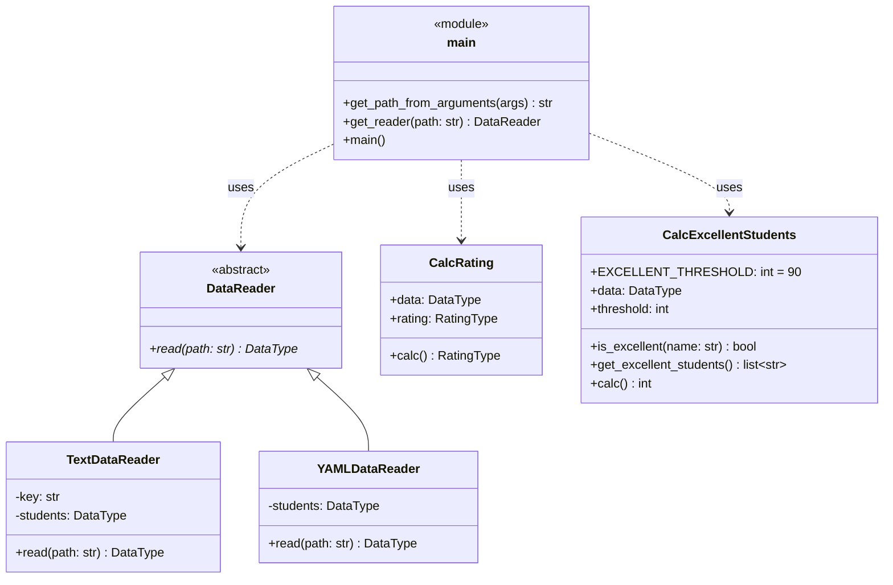

# Лабораторная 1 по дисциплине "Технологии программирования"


**Тема:** знакомство с системой контроля версий Git и инструментом CI/CD GitHub Actions.
**Вариант:** 1 (формат входного файла — YAML; расчет количества студентов-отличников).

## Постановка задачи

Дан проект `rating`, рассчитывающий средний рейтинг студентов по дисциплинам. Требуется:

1. Выбрать для проекта тип лицензии и добавить файл с лицензией.
2. Добавить в проект файл `.gitignore`.
3. Добавить класс-наследник `DataReader`, обрабатывающий входной файл формата **YAML**,
   и модульные тесты к нему (работа в отдельной ветке с последующим слиянием в `main`).
4. Добавить класс, рассчитывающий и выводящий на экран **количество студентов-отличников**
   (имеющих баллы по всем предметам ≥ 90), и модульные тесты к нему (отдельная ветка).
5. Составить UML-диаграмму классов итогового проекта.
6. Проанализировать результаты и сделать выводы.

## Описание проекта

```
rating
├── .github/workflows/github-actions-testing.yml   # конвейер CI (GitHub Actions)
├── data/data.txt, data/data.yaml                  # входные данные
├── docs/uml_classes.png                           # UML-диаграмма классов
├── src/
│   ├── Types.py                  # псевдонимы типов (Type Hints)
│   ├── DataReader.py             # абстрактный класс чтения данных
│   ├── TextDataReader.py         # чтение из .txt
│   ├── YAMLDataReader.py         # чтение из .yaml/.yml (вариант 1)
│   ├── CalcRating.py             # расчет среднего рейтинга
│   ├── CalcExcellentStudents.py  # расчет количества отличников (вариант 1)
│   └── main.py                   # точка входа
├── test/                         # модульные тесты pytest
├── LICENSE                       # MIT
├── .gitignore
└── requirements.txt
```

Класс чтения выбирается по расширению входного файла (`get_reader`):
`.yaml`/`.yml` → `YAMLDataReader`, иначе → `TextDataReader`.

Формат YAML-файла:

```yaml
- Иванов Иван Иванович:
    математика: 67
    литература: 100
    программирование: 91
```

## Используемые технологии

Python 3.10, PyYAML, pytest, pycodestyle (PEP 8), Git, GitHub Actions.

## Запуск

```bash
pip install -r requirements.txt
pycodestyle src test
PYTHONPATH=./:./src pytest test          # Windows PowerShell: $env:PYTHONPATH = "./:./src"
python src/main.py -p data/data.yaml
```

Пример вывода:

```
Rating:  {'Иванов Иван Иванович': 86.0, 'Петров Петр Петрович': 75.33333333333333, 'Сидорова Анна Сергеевна': 95.66666666666667, 'Кузнецов Олег Игоревич': 91.33333333333333}
Excellent students:  ['Сидорова Анна Сергеевна', 'Кузнецов Олег Игоревич']
Number of excellent students:  2
```

## UML-диаграмма классов




## Ветки разработки

* `main` — основная ветка;
* `feature/yaml-reader` — класс `YAMLDataReader` и тесты к нему;
* `feature/excellent-students` — класс `CalcExcellentStudents` и тесты к нему.

Обе ветки слиты в `main` (`git merge --no-ff`).

## Выводы

В ходе работы изучена распределенная система контроля версий Git (индексирование, фиксация
изменений, ветвление и слияние веток, работа с удаленным репозиторием) и инструмент
непрерывной интеграции GitHub Actions. Проект дополнен классом чтения данных из YAML и классом
подсчета количества отличников; для них написаны модульные тесты (всего 28 тестов, покрытие
кода — 98 %). При каждом `push` в ветку `main` GitHub Actions автоматически проверяет код
на соответствие PEP 8 и запускает тесты; намеренно внесенная ошибка была обнаружена конвейером CI
до ее исправления. Использование абстрактного класса `DataReader` позволило добавить новый формат
входных данных без изменения остального кода (принцип открытости/закрытости).
